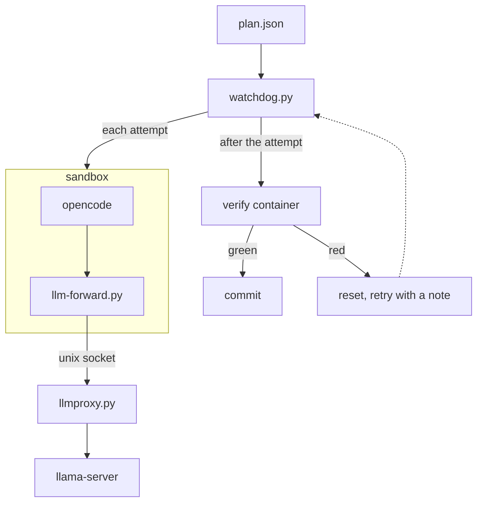

# local-llm-harness

A small harness that lets a **local LLM** (Qwen 27B on llama.cpp) work through a plan of coding steps **unattended**: each step runs in a sandbox, is checked by the project's own tests in a fresh container, and is committed only when the checks pass.

It grew out of one real project, where a local model wrote most of the code through it over a few weeks (about 80 % of the steps passed on the first attempt). This repository is the neutral core plus what was learned: [LESSONS.md](LESSONS.md).

## How it fits together



- **sandbox:** a fresh podman container and opencode session per attempt: `--network=none`, read-only root, no capabilities.
- **llmproxy.py:** a thread in the watchdog; adds the API key, caps thinking, logs every request. llama-server runs from `llm.sh` (llama.cpp in rootless podman).
- **verify container:** also fresh; checks allowed paths, runs the verify commands, makes sure the test count did not drop. Green: commit `Step <id>: …`.

| File | What it does |
|---|---|
| [watchdog.py](watchdog.py) | Runs a plan step by step: a fresh sandbox and opencode session per attempt, stall and loop detection, its own verification, retries with specific notes, the commit. `watchdog.py PLAN.json [--dry-run] [--once]` |
| [sandbox.py](sandbox.py) | The agent's container and the verify container. Isolation instead of approval: a real shell, but no network, no git, no podman, the `.git` pointer read-only. |
| [llmproxy.py](llmproxy.py) | The sandbox's only way out (chat completions only). The API key never enters the sandbox. Optional thinking budget and dropping of old thinking. Logs every request; `llm-live.txt` for the live view. |
| [watch.py](watch.py) | Follow a running step from a second terminal (reading, writing, testing, fixing). |
| [llm.sh](llm.sh) | Start and stop llama-server in rootless podman (model, context and port at the top). |
| [night.sh](night.sh) | Run several plans unattended: the LLM up, the plans in order, the LLM down; optionally skip a failed step and go on ([skip_step.py](skip_step.py)). |
| [stop-after.sh](stop-after.sh) | Stop a running plan once a given step is committed. |
| [sandbox/](sandbox/) | The sandbox image (Python and ripgrep; add your toolchain), the in-sandbox forwarder, opencode's config (its `apiKey` is a placeholder). |
| [examples/hello/](examples/hello/) | A complete two-step example on a tiny Python repo. |
| [examples/rust/](examples/rust/) | How to give the offline sandbox a Rust toolchain and vendored crates. |

## Quick start (the hello example)

Requirements: Linux, rootless podman, systemd user units (for `night.sh`), an NVIDIA GPU for a 27B model, [opencode](https://opencode.ai) installed on the host (it's mounted into the sandbox; set `WATCHDOG_OPENCODE_BIN` if it isn't `/usr/bin/opencode`), Python 3 on the host, standard library only (tested with 3.14).

```bash
mkdir -p ~/.config/llm && head -c 32 /dev/urandom | base64 > ~/.config/llm/api-key && chmod 600 ~/.config/llm/api-key
./llm.sh start                                   # downloads the model on the first start
podman build -t localhost/qwen-sandbox sandbox/
examples/hello/make-repo.sh ~/qwen-hello
# edit examples/hello/plan.json: repo, worktree, prompts_dir to your paths
./watchdog.py examples/hello/plan.json --dry-run # shows the first step's prompt
./watchdog.py examples/hello/plan.json           # runs it; watch with ./watch.py in a second terminal
```

The steps land as commits `Step H1: …`, `Step H2: …` on the branch `hello` in the worktree; logs are in `runs/hello/`. For unattended runs put plans into `plans/` and start `systemd-run --user --unit=qwen-night ./night.sh PLAN ...`.

## Plan reference

A plan is one JSON file; its name (without `.json`) names the run folder, lock and containers.

| Key | Meaning |
|---|---|
| `repo`, `worktree`, `branch`, `base` | The repository, the worktree the watchdog creates (from `base`, or reuses), the branch the steps are committed to. A step counts as done when a commit `Step <id>: …` exists in `base..HEAD`, so `base` must not be the branch itself: to continue an existing branch, give the commit to start from (the watchdog refuses such a plan). |
| `prompts_dir` | Where the step prompts live (outside the worktree, so Qwen can't change them). |
| `sandbox` | `image` (required), `cpus`, `memory`, `pids`, `env`, `agent_env` (only the agent's container), `mounts` (`"HOST:CONTAINER[:ro]"`, `{cache}` and `{here}` filled in), `volumes` (container paths backed by a named volume per plan), `tmpfs`. |
| `prepare` | Host commands that fetch what the offline sandbox needs into `cache/<plan>/` (`{worktree}`, `{cache}`), run again when one of the `inputs` changes. |
| `environment_note` | One sentence for the prompt about the sandbox (e.g. "Cargo works offline against vendored crates under /vendor"). |
| `verify` | The commands every step must pass, run in a fresh container with the worktree read-only. An entry is a string or `{"cmd": ..., "note": ...}`; the note tells Qwen how to use it (e.g. "slow: run only the part your change touches"). Every command runs, also after one failed. |
| `vars` | Values for `{name}` placeholders in the commands; a step's `vars` override them. `{require}` becomes the step's `require` patterns. |
| `fail_patterns` | Regexes whose group 1 names a failed check (default `^FAIL (\S+)`); `{"regex": ..., "prefix": "x/"}` to tell kinds apart. Used for the preflight and the retry notes. |
| `passed_pattern` | Regex for the passed-test count (default `(\d+) passed`), summed over the plan's own `verify` commands; a step may not lower it (unless `allow_fewer_tests`). |
| `max_lines` | Optional `{"patterns": [...], "warn": N, "limit": M}`: files over `warn` are named in the prompt, a changed file over `limit` fails the step. |
| `forbidden`, `protected` | Paths no step may change (git internals and opencode's config always); paths whose change pauses the plan for a human review. |
| `no_read` | Globs the read tool refuses (e.g. a big test harness Qwen reads in circles). |
| `material` | A host folder mounted read-only at `/material` in the work sandbox only (never in the verification): decided code or a prototype the steps copy from, instead of pasting it into prompts. |
| `max_attempts`, `attempt_timeout_min`, `idle_timeout_min`, `verify_timeout_s`, `max_tool_errors_in_row`, `max_summaries_without_edit` | Limits per attempt. |
| `reasoning_budget`, `drop_old_thinking` | Thinking cap per request; drop the thinking of earlier replies from the history. |
| `context_tokens`, `opencode_context` | llama-server's `-c` and what opencode is told (keep the latter lower, so its session summary fits). |
| `model`, `commit_body` | opencode's model (default from its config); the commit message body. |
| `skip_failed`, `keep` | For `night.sh`: go on after a failed step, except the steps in `keep` (later steps depend on them). |
| `steps` | The steps, in order (below). |

A **step**: `id` (e.g. `S1`, `S2a`), `title`, `prompt` (`file.md#S1`: the file's shared `## ` sections plus its own `## S1 …` section), `allowed` (path globs it may change), `extra_verify` (its own gates), `require` (check patterns that must pass, `!pattern` excludes), `fixes` (checks failing on the base that this step is meant to fix; any other required check failing on the base stops the plan before an attempt), `vars`, `max_attempts`, `attempt_timeout_min`, `pause_after` (stop after this step, run the `checkpoint` commands), `after` (host commands after the commit, their changes committed if inside `after.allowed`), `type: "review"` (a read-only review that writes a report).

## Writing steps that pass

The planner works as the architect, the model executes: the model has no network, no documentation and no search, so the planner gathers what each step needs, decides every design question and adapts the harness, and the step prompt hands over a decided task. Details in [LESSONS.md](LESSONS.md), above all "The roles" and "Writing steps (the planner's checklist)".

## Security model, briefly

The model runs arbitrary commands, so everything rests on the container: no network (the proxy socket is the only way out, and it passes only chat completions), read-only root, all capabilities dropped, uid 1000, the worktree as the only writable path, no git and the `.git` pointer read-only. The watchdog itself, the plans, prompts and logs live outside the worktree; every host-side git call runs with hooks and fsmonitor disabled and checks that the `.git` pointer file is unchanged. Anything that later runs the model's code on the host (an image build, a generator) must run it in a container too. Never weaken these to save time: reduce how often a slow check runs instead.

## License

MIT, see [LICENSE](LICENSE).
